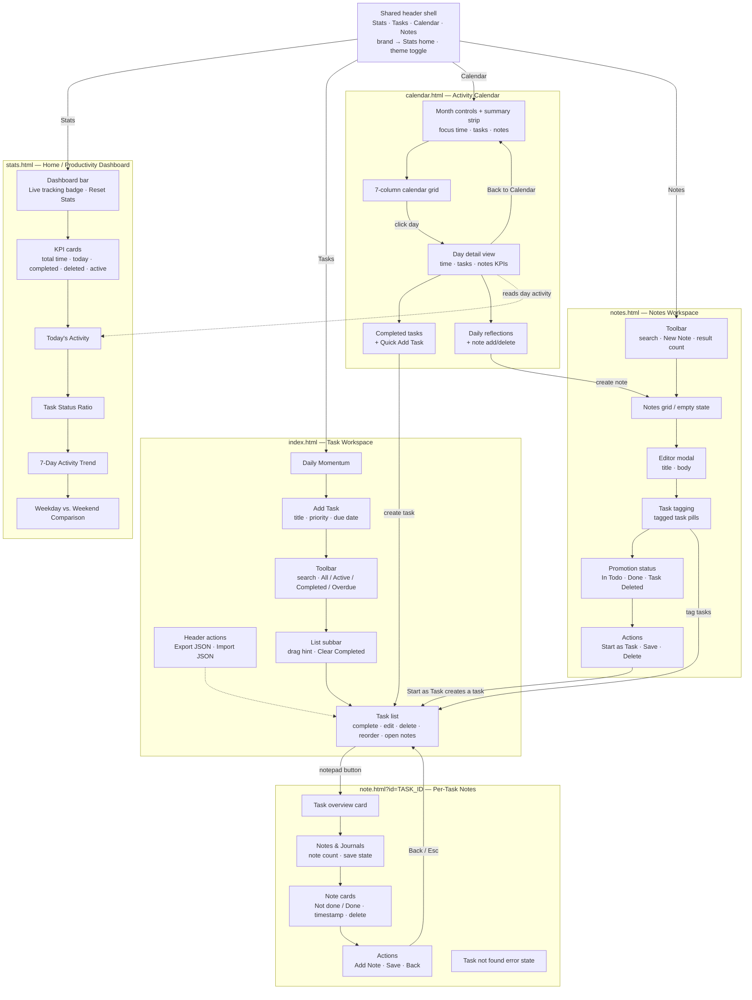

# FocusFlow — Native To-Do, Calendar, Notes & Productivity Analytics

A high-fidelity personal productivity suite built with **pure native HTML5, CSS3, and modern Vanilla JavaScript (ES6+)**, packaged as a secure **Electron** desktop app. No frameworks, no external runtime libraries, no icon fonts.

FocusFlow is split into four connected workspaces, all reachable from a shared header navigation (**Stats → Tasks → Calendar → Notes**) with an active-state highlight:

- **Stats** (`stats.html`) — the default home screen: a live productivity and time-tracking dashboard.
- **Tasks** (`index.html`) — the main task list, per-task notes, and JSON import/export.
- **Calendar** (`calendar.html`) — a monthly activity calendar with a per-day detail view, quick task creation, and daily reflections.
- **Notes** (`notes.html`) — a freeform notes workspace with task tagging and note-to-task promotion.

The brand/logo in the header always links back to **Stats**, the app's home. Per-task note pages (`note.html?id=…`) open from the task list.

Designed with strict adherence to **anti-slop design principles**, multi-layer ambient depth, strict 8px spatial rhythm, tactile micro-feedback, and accessible interactions.

---

## ✨ Features

### 📋 Core Task Management (`index.html`)
- **Add Tasks**: Fast input field with <kbd>Enter</kbd> support, priority selector (High, Medium, Low), and due date picker.
- **Inline Editing**: Double-click any task title or click the Edit button to edit in place. Press <kbd>Enter</kbd> to save or <kbd>Esc</kbd> to cancel.
- **Drag-and-Drop Reordering**: Reorder tasks directly in the list; the order is persisted.
- **Search & Filter**: Keyword search plus All / Active / Completed / Overdue tabs, with a live result count.
- **Micro-Interactions**: Custom checkbox with spring checkmark animation, strike-through transition, and priority color bars.
- **Undoable Deletion**: Deleting single tasks or clearing completed tasks triggers a 5-second toast banner with an instant **Undo** button.
- **Daily Momentum Progress**: Dynamic percentage bar with contextual feedback based on completion rate.
- **Priority System**:
  - 🔴 **High Priority**: Crimson accent with soft badge
  - 🟡 **Medium Priority / In-Progress**: Warm amber accent
  - 🔵 **Low Priority**: Subtle slate-blue accent
  - 🟢 **Completed**: Emerald green accent

### 📝 Per-Task Notes & Journal (`note.html?id=TASK_ID`)
- **Dedicated Notes Page**: Every task has a dedicated multi-note editor accessible via the notepad button on each task card.
- **Per-Note Done Status**: Each note has a `Not done` / `Done` segmented control. The state is stored as `completed` on the note and reflected by a green accent on the note card.
- **Save Without Leaving**: **Save** persists changes in place, keeps your inputs and cursor position intact, shows a success toast, and never redirects. The notes header shows a live `Unsaved changes` / `Saving…` / `All changes saved` status.
- **URL Note Anchor**: Saving a new or edited note updates the URL in place (`note.html?id=TASK_ID&note=NOTE_ID`) with `history.replaceState`, so refreshing or saving again targets the same note instead of creating duplicates.
- **Visual Note Indicator**: Tasks with notes display a badge with the note count (`Note` or `3 notes`) and the note button gets an accent. The badge tooltip also reports how many notes are done.
- **Auto-Resizing Textarea**: Fluid auto-resizing textarea that expands dynamically as you write.
- **Timestamps**: Displays the last-saved timestamp per note; it only advances when the note's content or done state actually changes.
- **Clear & Delete Notes**: Delete individual notes with confirmation; a single remaining note is cleared in place instead.
- **Return Safeguards**: `Back`, `Esc`, refresh, and tab close warn when staged changes have not been saved. Filter and scroll position are preserved when returning to the task list via `sessionStorage`.

### 🗒️ Notes Workspace (`notes.html`)
- **Standalone Notes**: Create, edit, search, and delete freeform notes independently of any task, stored separately from the task list.
- **Inline Editor Modal**: A focused note editor with title, body, task tagging, promotion status, save, and delete actions.
- **Task Tagging**: Tag any note with one or more tasks. Tagged tasks appear as status-aware pills (active / done / missing) on the note card and in the editor.
- **Note-to-Task Promotion**: Use **Start as Task** to promote a note into the Todo table. The note body becomes the task's first note, and the note is linked back to the created task.
- **Promotion Status**: Promoted notes show a badge reflecting the linked task's live state — `In Todo Table`, `Done`, or `Task Deleted`. Deleted promotions can be re-promoted.
- **Search & Counts**: Live search across note titles and bodies with a matching-result count.
- **Dark Mode**: Shared theme preference across every workspace.

### 📊 Productivity & Time Tracking (`stats.html`)
- **KPI Cards**: Total time in app, today's focus time, tasks completed (with completion rate), tasks deleted, and active/remaining tasks.
- **Today's Activity**: Completed, created, and deleted tasks for today plus time spent, with a contextual momentum message.
- **Task Status Ratio**: Stacked bar and legend showing the completed / active / deleted lifecycle mix.
- **7-Day Activity Trend**: Pure SVG/CSS chart with a metric switcher for **Tasks Done**, **Focus Time**, or **Dual View**, including hover tooltips and weekend highlighting.
- **Weekday vs. Weekend Comparison**: Total and daily-average completed tasks and focus time for Monday–Friday versus Saturday–Sunday.
- **Continuous Runtime Tracking**: Time is recorded for the entire time the app is running — including while minimized, unfocused, or in the background. The Electron window sets `backgroundThrottling: false` so timers stay accurate when hidden. Deltas are measured with `Date.now()` timestamps, buffered in memory, persisted every 10 seconds, and flushed on `beforeunload` / `pagehide`.
- **Midnight-Safe Accounting**: If the app remains open across midnight, accumulated time is split into the correct local-date buckets instead of being attributed entirely to one day.
- **Reset Stats**: Reset historical statistics behind a confirmation dialog. Task data is left untouched.
- **Dark Mode**: Shared theme preference across every workspace.

### 🔗 Notion API Integration & UI-Friendly Page Linking
- **Notion API Workspace Connection**:
  - Connect your Notion workspace using an Internal Integration Token (`secret_...` or `ntn_...`).
  - Top-bar connection status indicator (`Connected` emerald dot with workspace name / `Not Connected`).
  - Compact **Notion Connection Modal** with token show/hide eye toggle, step-by-step setup guide, and **Test & Save Connection** calling `GET https://api.notion.com/v1/users/me` to verify workspace and bot details.
  - One-click **Disconnect** option leaving existing task/note links intact.
- **Main Process Security Isolation**:
  - All Notion API requests (`/v1/users/me`, `/v1/search`) execute strictly in Electron's **Main Process** (`notionService.js`).
  - Secret integration token is stored in the Electron `userData` directory with restricted file permissions (`0o600`) and is **never** leaked or exposed across the IPC bridge to renderer scripts.
- **Interactive Friction-Free Page Picker**:
  - Dynamic typeahead search dropdown calling `POST https://api.notion.com/v1/search` with a 250ms debounce and page filtering.
  - Dropdown displays live page emojis, custom icons, page titles, and relative edit timestamps ("just now", "2h ago", "yesterday").
  - Full keyboard navigation (<kbd>ArrowDown</kbd>, <kbd>ArrowUp</kbd>, <kbd>Enter</kbd> to select, <kbd>Esc</kbd> to dismiss).
  - Also accepts direct pasted Notion URLs (`https://app.notion.com/p/...`, `https://www.notion.so/...`, `https://*.notion.site/...`, `notion://...`).
- **Live Page Badges**:
  - Linked tasks and notes display the authentic page emoji or icon alongside the live page title directly on task cards and note cards.
  - Hover tooltip displays the full title and URL; clicking opens the page directly via Electron's `shell.openExternal()`.
- **Cross-Workspace Support**:
  - The Notion connection pill and modal are integrated across all five workspaces (**Stats**, **Tasks**, **Calendar**, **Notes**, and **Task Notes**).
  - Backward-compatible schema with `notionUrl`, `notionTitle`, `notionIcon`, and `notionPageId` defaulting to `null` for legacy items.

### 🗓️ Activity Calendar & Day Detail (`calendar.html`)
- **Monthly Calendar Grid**: A true 7-column month grid (Sunday-first) with previous / Today / next month controls, dimmed adjacent-month cells, and a highlighted **Today** badge.
- **Monthly Summary Strip**: Live totals for month focus time, tasks completed, and notes/reflections for the visible month.
- **Per-Day Activity Indicators**: Each day cell shows compact pills for completed tasks (`N done`), focus time (`1h 20m`), and notes logged (`N notes`), derived from task completion timestamps and note dates.
- **Day Detail View**: Click any day (or focus it and press <kbd>Enter</kbd> / <kbd>Space</kbd>) to open a focused detail view with the full date, three KPI cards (time in app, tasks completed, notes logged), completed task rows with priority badges and completion times, and daily note cards.
- **Day Navigation**: Previous / Today / next day controls, plus **Back to Calendar** which synchronizes the month view to the selected day's month.
- **Quick Add Task**: Add a task directly to the selected date with a priority selector and an optional "mark completed" checkbox. Completed tasks get a `completedAt` timestamp and are counted in the correct day's stats.
- **Daily Reflections**: Write and save a dated note from the day view; existing notes for that date can be read and deleted inline.
- **Deep Links & History**: The selected day is reflected in the URL (`calendar.html?date=YYYY-MM-DD`), and browser back/forward navigation is supported via `popstate`.
- **Cross-Workspace Data**: The calendar reads the same tasks, standalone notes, and statistics as every other workspace, so changes made elsewhere appear immediately.
- **Dark Mode**: Shared theme preference across every workspace.

### 💾 Data Persistence & JSON Import/Export
- **LocalStorage Persistence**: Tasks, standalone notes, statistics, and theme are all persisted locally.
  - `focusflow_tasks_v1` — tasks (including `completedAt` and `notionUrl`) and per-task notes
  - `focusflow_notes_v1` — standalone notes workspace (including `notionUrl` and date used by calendar)
  - `focusflow_stats_v1` — productivity history, per-date counters, and time tracking
  - `focusflow_theme` — light/dark preference
- **JSON Export**: Download a timestamped `tasks-YYYY-MM-DD.json` file including all tasks and their per-task notes/timestamps.
- **JSON Import**: Upload any compatible JSON file with thorough schema validation, error feedback, backward compatibility with older task structures, and an undo option.
- **Completion Timestamps**: Marking a task complete stores an ISO `completedAt`; un-completing clears it. Legacy completed tasks fall back to `createdAt` so historical calendar cells and stats stay populated.
- **Dark Mode**: Toggle light/dark themes with system preference detection and persistent preference storage.

---

## ⌨️ Keyboard Shortcuts

### Main Task List (`index.html`)
| Shortcut | Action |
| :--- | :--- |
| <kbd>Ctrl</kbd> / <kbd>⌘</kbd> + <kbd>N</kbd> | Focus the "Add new task" input field |
| <kbd>/</kbd> | Focus the search filter input |
| <kbd>Enter</kbd> | Submit new task / Save inline edit |
| <kbd>Esc</kbd> | Cancel inline editing / Clear search / Close modal |

### Per-Task Note Editor (`note.html`)
| Shortcut | Action |
| :--- | :--- |
| <kbd>Ctrl</kbd> / <kbd>⌘</kbd> + <kbd>S</kbd> | Save notes and stay on the page |
| <kbd>Esc</kbd> | Return to tasks (warns if changes are unsaved) |

### Notes Workspace (`notes.html`)
| Shortcut | Action |
| :--- | :--- |
| <kbd>Ctrl</kbd> / <kbd>⌘</kbd> + <kbd>N</kbd> | Create a new note |
| <kbd>/</kbd> | Focus the notes search input |
| <kbd>Esc</kbd> | Close the note editor |

### Activity Calendar (`calendar.html`)
| Shortcut | Action |
| :--- | :--- |
| <kbd>Enter</kbd> / <kbd>Space</kbd> | Open the focused day's detail view |

The selected day is stored in the URL (`?date=YYYY-MM-DD`), so standard back/forward history navigation returns between the month and day views.

---

## 📁 Project Structure

```text
TodoAppElectron/
├── main.js           # Electron main process (secure window + lifecycle)
├── preload.js        # contextBridge / ipcRenderer bridge (no Node leakage)
├── package.json      # Electron deps, npm scripts, electron-forge packaging config
├── package-lock.json # Lockfile
├── smoke-test.js     # Headless smoke test (`npm test`)
├── src/              # Web frontend (static, no build step)
│   ├── stats.html    # Default home: productivity & time-tracking dashboard
│   ├── index.html    # Main task list & dashboard
│   ├── calendar.html # Activity calendar: month grid + day detail view
│   ├── notes.html    # Standalone Notes workspace (tagging + promotion)
│   ├── note.html     # Per-task multi-note editor page
│   ├── style.css     # Design system tokens, 8px grid, nav, calendar, dark mode & animations
│   ├── storage.js    # Shared task, note, stats storage + continuous time tracker
│   ├── app.js        # Main task list controller & interaction engine
│   ├── calendar.js   # Month rendering, day detail, quick tasks & daily reflections
│   ├── notes.js      # Standalone notes CRUD, tagging & note-to-task promotion
│   ├── note.js       # Per-task notes controller & save-in-place logic
│   └── stats.js      # Stats rendering, 7-day chart & weekday/weekend comparison
└── README.md         # Documentation and JSON format schema
```

---

## 🗺️ Page & Section Schema

The diagram below maps how every page is composed and how workspaces link to each other. Solid arrows are user navigation; dotted arrows are data reads or special transitions. All pages share the same header shell, theme preference, and `FocusFlowStorage` data layer.



### Page Map

| Page | Route | Main sections (top → bottom) | Primary exits |
| :--- | :--- | :--- | :--- |
| **Stats (Home)** | `stats.html` | Dashboard bar (live badge, Reset Stats) → 5 KPI cards → Today's Activity → Task Status Ratio → 7-Day Activity Trend → Weekday vs. Weekend Comparison | Shared nav; Reset confirmation dialog |
| **Tasks** | `index.html` | Header actions (Import / Export) → Daily Momentum → Add Task → Search & filter tabs → List subbar (drag hint, Clear Completed) → Task list → toasts / confirmation dialog | Notepad button → per-task notes; shared nav |
| **Calendar** | `calendar.html` | Month controls + monthly summary → 7-column month grid → Day Detail View (KPIs → completed tasks + Quick Add Task → daily reflections) | Shared nav; day cells → day view; Back to Calendar |
| **Notes** | `notes.html` | Toolbar (search, New Note, count) → notes grid / empty state → editor modal (title, body, task tagging, promotion, actions) | Shared nav; Start as Task → Tasks |
| **Per-Task Notes** | `note.html?id=TASK_ID` | Task overview card → Notes & Journals (count, save state, note cards) → action bar (Add Note, Save, Back) → error state for invalid IDs | Back / Esc → Tasks; brand → Stats |

### Cross-Workspace Relations

| From | Trigger / section | To | Effect |
| :--- | :--- | :--- | :--- |
| Any main page | Header nav | Stats / Tasks / Calendar / Notes | Standard page navigation with active-state highlight. |
| Any main page | Brand logo | `stats.html` | Returns to the home dashboard. |
| Tasks | Notepad button on a task card | `note.html?id=…` | Opens that task's multi-note editor. |
| Per-Task Notes | Back button, <kbd>Esc</kbd>, error-state link | `index.html` | Returns to the task list, warning first if changes are unsaved. |
| Notes | **Start as Task** | Tasks | Promotes the note into a new task; the note body becomes the task's first note and links back via `promotedTaskId`. |
| Notes | Task tagging | Tasks | Tagged tasks appear as status-aware pills and are matched live against the task list. |
| Calendar | Quick Add Task | Tasks | Creates a task for the selected date, optionally completed, and records it in stats. |
| Calendar | Daily reflection | Notes | Creates a dated standalone note visible on that calendar day and in the Notes workspace. |
| Calendar | Day detail | Stats | Reads per-day time, completed tasks, and note activity from the shared stats/task/note data. |
| Stats | KPI cards, trends | Shared data | Aggregates task lifecycle counters, completion history, and continuous time tracking across all workspaces. |

### Shared Data Layer

Every page loads `storage.js` and reads/writes the same `FocusFlowStorage` singleton:

```text
stats.html ─┐
index.html ─┤
calendar.html ┼──> FocusFlowStorage ──> localStorage
notes.html ─┤        ├── focusflow_tasks_v1   (tasks + completedAt + per-task notes)
note.html ──┘        ├── focusflow_notes_v1   (standalone dated notes)
                     ├── focusflow_stats_v1   (time + daily counters + history)
                     └── focusflow_theme     (light / dark)
```

- **Tasks** owns task CRUD and exports/imports JSON.
- **Per-Task Notes** owns the `notes` array inside each task.
- **Notes** owns standalone notes, tagging, and promotion.
- **Calendar** is a cross-workspace view: it reads tasks/notes/stats and writes quick tasks and daily notes.
- **Stats** is an aggregate view over task lifecycle data and time buckets; it does not own domain data beyond counters and history.

---

## 📄 JSON Data Format (Extended)

FocusFlow imports and exports tasks conforming to the following structure:

```json
{
  "appName": "FocusFlow",
  "version": "1.3",
  "exportedAt": "2026-11-09T12:00:00.000Z",
  "tasks": [
    {
      "id": "task-seed-1",
      "title": "Review quarterly design tokens and typography hierarchy",
      "completed": false,
      "priority": "high",
      "dueDate": "2026-11-10",
      "createdAt": "2026-11-09T10:00:00.000Z",
      "completedAt": null,
      "notes": [
        {
          "id": "note-1-1",
          "content": "Check line-height rhythm on mobile devices and verify contrast on dark mode surfaces.",
          "completed": false,
          "createdAt": "2026-11-09T10:05:00.000Z",
          "updatedAt": "2026-11-09T11:30:00.000Z"
        },
        {
          "id": "note-1-2",
          "content": "Coordinate with engineering lead on CSS custom properties structure.",
          "completed": true,
          "createdAt": "2026-11-09T10:10:00.000Z",
          "updatedAt": "2026-11-09T11:45:00.000Z"
        }
      ],
      "note": "Coordinate with engineering lead on CSS custom properties structure.",
      "noteUpdatedAt": "2026-11-09T11:45:00.000Z"
    }
  ]
}
```

### Field Definitions
- **`id`** (`string`, required): Unique identifier for the task.
- **`title`** (`string`, required): Task description text (1–200 characters).
- **`completed`** (`boolean`, required): `true` if the task is marked finished, `false` otherwise.
- **`priority`** (`string`, optional): `"high"`, `"medium"`, or `"low"` (defaults to `"medium"`).
- **`dueDate`** (`string`, optional): Date string formatted as `"YYYY-MM-DD"`.
- **`createdAt`** (`string`, optional): ISO 8601 timestamp string.
- **`completedAt`** (`string` | `null`, optional): ISO 8601 timestamp of when the task was last marked complete; `null` while active. Un-completing a task clears it. On import, completed tasks without this field fall back to `createdAt` (or `dueDate` for calendar matching).
- **`notes`** (`array`, optional): Ordered list of note cards. Empty notes are not persisted.
- **`notes[].id`** (`string`, required): Unique identifier for the note.
- **`notes[].content`** (`string`, required): Note body.
- **`notes[].completed`** (`boolean`, optional): Per-note done state; defaults to `false`.
- **`notes[].createdAt`** (`string`, optional): ISO 8601 creation timestamp.
- **`notes[].updatedAt`** (`string`, optional): ISO 8601 timestamp of the last content/status change.
- **`note`** (`string`, optional): Backward-compatible computed mirror of the latest note's content.
- **`noteUpdatedAt`** (`string` | `null`, optional): Backward-compatible computed timestamp of the latest note.

Older single-note files containing only `note` / `noteUpdatedAt` are still imported and normalized into a one-item `notes` array with `completed: false`.

### Standalone Notes Format

Notes created in the Notes workspace are stored separately under `focusflow_notes_v1` (and are not included in the task JSON export):

```json
{
  "id": "note_abc123",
  "title": "Launch checklist",
  "body": "Draft the announcement and review the release notes.",
  "date": "2026-11-09",
  "taggedTaskIds": ["task-seed-1"],
  "promotedTaskId": "task-xyz789",
  "createdAt": "2026-11-09T10:00:00.000Z",
  "updatedAt": "2026-11-09T11:00:00.000Z"
}
```

- **`date`** (`string`, optional): Local calendar date (`"YYYY-MM-DD"`) the note belongs to. Defaults to the local date derived from `createdAt`. Used by the Activity Calendar; notes are matched by `date`, then `createdAt`, then `updatedAt`.
- **`taggedTaskIds`** (`string[]`, optional): Tasks this note is associated with.
- **`promotedTaskId`** (`string`, optional): The task created from this note via **Start as Task**.

### Statistics Format

Statistics are stored under `focusflow_stats_v1` and include cumulative counters (`totalTimeSeconds`, `totalCompleted`, `totalDeleted`, `totalCreated`), per-day activity (`timeSeconds`, `completed`, `deleted`, `created`) keyed by local date, and a bounded (last 300 entries) history log.

Time is recorded continuously while the Electron app is running, not just while focused. The tracker accumulates `Date.now()` deltas into a buffer, persists every ~10 seconds via `recordActiveTime(seconds, dateStr)`, flushes on unload, and splits the buffer across midnight so each day is credited correctly.

### Shared Storage Helpers

`storage.js` exposes a single `window.FocusFlowStorage` object shared by every workspace. In addition to task/note CRUD and metrics, the calendar uses:

| Helper | Purpose |
| :--- | :--- |
| `getLocalDateString(date?)` | Format a `Date` (or now) as a local `"YYYY-MM-DD"` string; safely falls back to today for invalid input. |
| `getUsageByDate()` | Map of `"YYYY-MM-DD"` → recorded `timeSeconds`. |
| `getTasksCompletedForDate(dateStr)` | Completed tasks for a date, preferring `completedAt`, then `dueDate`, then `createdAt`. |
| `getNotesForDate(dateStr)` | Notes whose `date`, `createdAt`, or `updatedAt` match the date. |
| `getDayActivity(dateStr)` | Combined day payload: time, formatted time, stats count, completed tasks, and notes. |
| `toggleTaskCompletion(id)` | Toggle completion, set/clear `completedAt`, update stats, and persist. |
| `addTaskForDate(title, priority, dateStr, markCompleted)` | Create a task for a specific calendar day; optionally record it as completed. |
| `addDailyNote(dateStr, noteData)` | Create a dated reflection note for the calendar's day view. |

---

## 🖥️ Running as an Electron Desktop App

The static site is wrapped in a secure Electron shell. The web UI is loaded from the local file system via `file://`, so markup, styles, business logic, localStorage persistence, and all workspace navigation (`stats.html`, `index.html`, `calendar.html`, `notes.html`, `note.html?id=…`) behave exactly as they do in a browser.

The app opens directly on **Stats** (`stats.html`), which acts as the home dashboard. The header brand logo always returns there. `backgroundThrottling` is disabled so the continuous time tracker keeps accurate timestamps even when the window is minimized or unfocused.

### Install & run

```sh
# 1. Install dependencies (Electron + electron-forge)
npm install

# 2. Launch the desktop app
npm start
```

### Test without breaking existing behavior

```sh
# Headless smoke test: verifies the task list, the per-task note editor,
# the Stats default-home route, the Calendar month → day-detail transition,
# the preload bridge, and the Content Security Policy render correctly.
npm test
```

> On locked-down CI/containers that lack a display or the Chromium sandbox,
> the smoke test already runs headlessly (`--ozone-platform=headless`); if a
> specific container also forbids user namespaces, add the flag manually:
> `npx electron --no-sandbox smoke-test.js`.

### Package a distributable

```sh
# Build an unpacked app bundle
npm run package

# Build platform installers (Squirrel / ZIP / DEB via electron-forge)
npm run make
```

### Run the original web app (no Electron)

No build step or server required:

```sh
# Opens the Stats home dashboard; use the header nav from there.
xdg-open src/stats.html
# or serve locally:
python3 -m http.server 8000 --directory src
```

Open **Stats** (home), **Tasks**, **Calendar**, or **Notes** from the header navigation, or click the notepad icon on any task card to open its per-task notes page (`note.html?id=…`). The calendar supports direct links to a day, e.g. `calendar.html?date=2026-11-16`.
